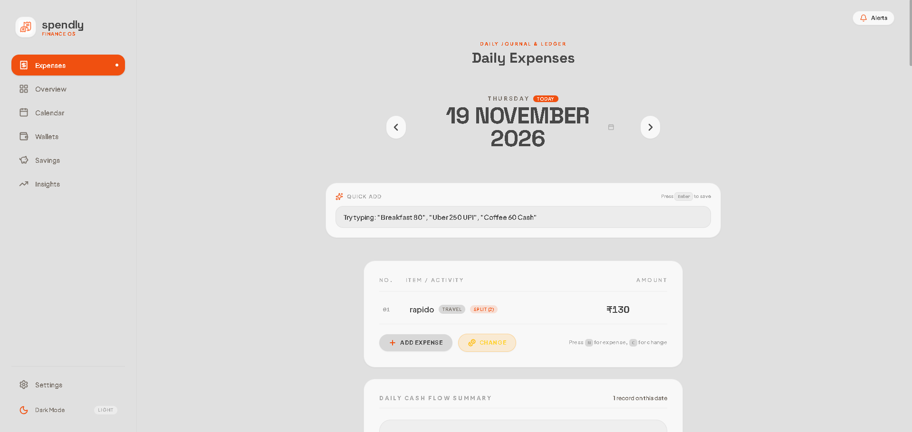

# Spendly

> A minimalist personal finance tracker for everyday spending in ₹. Log expenses and income, split payments across wallets, set aside savings, and see where your money goes.


<!-- TODO: replace with your deployed link, e.g. Vercel/Netlify -->
**Live demo:** _coming soon_

<!-- TODO: add 2-3 screenshots or a GIF here, e.g.

-->

## Features

- **Daily ledger**: add, edit and delete expenses and income, with calendar-based date navigation
- **Wallets**: cash and bank/UPI accounts with transfers between them (net worth stays unchanged)
- **Hybrid payments**: split one expense across multiple wallets
- **"Change" handling**: change received is netted against spending so totals stay accurate
- **Savings pots**: contribute to goals without counting them as expenses
- **Insights**: charts of spending patterns (Recharts)
- **Transaction history**: searchable and filterable
- **Backup & restore**: full JSON backup/restore plus CSV export
- **Light/dark themes**, reduced-motion option, and in-app alerts when a wallet goes negative
- **Private by design**: all data stays in your browser (`localStorage`), no tracking, no account needed

## Tech Stack

React 18 · TypeScript · Vite · Tailwind CSS 4 · Framer Motion · React Router · Recharts · date-fns · ESLint

## Architecture Highlights

- **Repository pattern**: UI talks to a `FinanceRepository` interface; today it is backed by `localStorage`, and the design lets a Supabase implementation drop in without touching components.
- **Integer money math**: amounts are handled in paise (minor units) to avoid floating-point errors.
- **Safe storage wrapper** (`src/lib/storage.ts`) with error handling and SSR guards.
- **Context + hooks** for state (`FinanceContext`, `ExpenseContext`, `ThemeContext`, `useFinance`, `useTheme`).

```
src/
├── components/   # layout + reusable UI pieces
├── context/      # Finance, Expense, Theme, Navigation providers
├── hooks/        # useFinance, useExpenses, useTheme
├── lib/          # safeStorage wrapper
├── pages/        # Overview, CalendarView, Wallets, Savings, Insights, TransactionHistory, Settings
├── services/     # repository interfaces + local implementation
├── types/        # domain models
└── utils/        # calculations, currency, dates
```

## Getting Started

Requires Node.js 20.19+ (22 recommended).

```bash
git clone https://github.com/SakethRoyal01/Spendly.git
cd Spendly
npm install
npm run dev
```

| Command | What it does |
| --- | --- |
| `npm run dev` | Start the dev server |
| `npm run build` | Type-check and build for production |
| `npm run lint` | Run ESLint |
| `npm test` | Run the ledger scenario checks |

## Roadmap

- [ ] Deploy a live demo
- [ ] Supabase backend with auth and row-level security (design in [`docs/BACKEND_INTEGRATION_PLAN.md`](docs/BACKEND_INTEGRATION_PLAN.md))
- [ ] Unit tests that import the real app utilities (Vitest)
- [ ] PWA / offline install

## License

[MIT](LICENSE)
